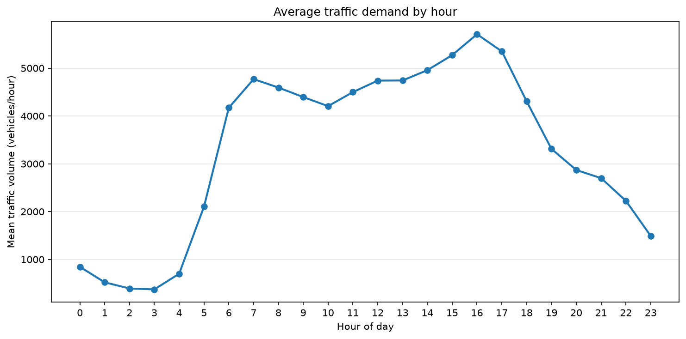

# Smart-City Traffic Capstone
## Final report: methodology and findings across Parts 1–3

### Executive summary

This project examined hourly traffic and weather on the Metro Interstate corridor using SQL and Power BI (Part 1), a Python data pipeline and descriptive tools (Part 2), and machine-learning, recommendation and MLOps simulations (Part 3). Across the analyses, time of day and day type showed the clearest relationship with traffic. Weather comparisons were smaller and observational. The results describe recorded historical data; they do not establish causes, safety impacts or performance on other roads.

The source contains 48,204 records. After duplicate handling, the processed dataset has 40,575 hourly rows from 2 October 2012 to 30 September 2018. Coverage is uneven, with complete months absent and 2018 partial.

## Part 1 – Data Analytics: Understanding Traffic Patterns

| Task | Method | Main findings |
|---|---|---|
| **1. SQL traffic analysis** | Loaded the source into SQLite; queried yearly traffic averages and holiday temperature/traffic comparisons. | Yearly totals are distorted by missing coverage. Average hourly traffic remained about 3,200–3,300 through 2016, then reached 3,377 in 2017 (about 5.6% above 2016). Holiday comparisons did not show a consistent temperature–traffic link. |
| **2. Descriptive statistics and correlation** | Calculated traffic summary statistics and a temperature–volume correlation; reviewed the distribution. | Mean 3,290.65, median 3,427, standard deviation 1,984.77, and range 0–7,280 vehicles/hour. The histogram is bimodal; temperature correlation is weak (r = 0.1393; about 2% of variation). |
| **3. Probability and congestion** | Defined congestion as >5,500 vehicles/hour; compared probabilities and clear/cloudy odds. | 6,107 hours (15.05%) met the congestion definition. Congestion occurred in 13.2% of clear versus 17.1% of cloudy hours (odds ratio 0.736): a modest association, not evidence of causation. |
| **4. Power BI dashboard** | Prepared fields in Power Query, created traffic categories and hour/temperature measures, and built interactive charts, KPI cards and filters. | Clouds had the highest well-supported weather mean (3,617); Fog was lower (2,724, n=201). Squall’s apparent low mean was based on one hour. The scatter plot reinforced the weak temperature relationship. |

### Historical demand profile

The Part 2 hourly chart below shows the pronounced overnight-to-daytime cycle. Part 1’s 2017 analysis similarly found a 16:00 peak and 03:00 low.

*Figure 1. Mean observed traffic by hour; existing project visualization, not recalculated for this report.*

## Part 2 – Python: Building a Reproducible Traffic Analytics Pipeline

| Task | Method | Main findings |
|---|---|---|
| **1. Cleaning pipeline** | Validated required columns and timestamps, standardized categories, removed exact duplicates and duplicate timestamps (first row retained), and imputed invalid temperature/rainfall using calendar-month medians. | Produced 40,575 hourly rows. The low-traffic observations of 23–24 July 2016 were retained and flagged, not treated as missing. |
| **2. Feature engineering** | Added calendar and cyclical-hour features, weather encodings, rain/snow indicators, z-scores, fixed-threshold traffic targets and a quartile-based `congestion_quartile`. | Created the feature dataset for analysis and later modelling; Low <4,500, Medium 4,500–5,500 inclusive, High >5,500 vehicles/hour. |
| **3. Visualizations** | Plotted hourly demand, weekday/weekend hourly profiles, traffic by weather with sample counts, and monthly congestion alongside observed coverage. | Mean demand peaked at 16:00 (5,708.6) and bottomed at 03:00 (373.2). Weekday mean was 3,557.4 versus 2,623.9 at weekends. Only 63 of 72 calendar months had records. |
| **4. Command-line analytics** | Built date/hour lookup, peak-period ranking, weekday/weekend comparison, quiet-hour ranking and date-specific weather lookup, with input validation. | The app provides reproducible summaries of the cleaned observations. Quiet-hour suggestions are pooled historical means, not forecasts. |

## Part 3 – Machine Learning and AI: Building an Intelligent Mobility Solution

| Task | Method | Main findings |
|---|---|---|
| **1. Supervised models** | Time-ordered 80/20 split; Linear Regression and Random Forest for volume, Logistic Regression and Random Forest for a `high_risk` proxy. Runs tracked in MLflow. | Same-hour Random Forest: MAE 239, R² 0.959; classifier F1 0.930. The classifier predicts a project-defined proxy based on traffic quartiles and weather, and includes weather as a feature; its score is not accident-prediction performance. |
| **2. Unsupervised analysis** | Standardized K-means features; selected six clusters for interpretability. Counted association rules for time, day type and weather groups against congestion quartiles. | Clusters separated weekday/weekend periods and a severe-weather group. Of 44 rules, 14 were marked informative; night/weekend aligned with Low congestion, while weekday afternoon aligned with Severe. Time and day type were stronger patterns than weather. |
| **3. Next-hour forecasting and explainability** | LSTM forecast from the prior 24 consecutive hourly readings; compared against Random Forest and baselines. SHAP was applied to the Random Forest comparison model. | LSTM MAE 155 (R² 0.986); Random Forest MAE 147. Only 7,686 of 8,115 test hours had full 24-hour history. SHAP describes the forest, not the LSTM. |

## Part 3 — continued

| Task | Method | Main findings |
|---|---|---|
| **4. MLflow registry** | Audited experiment runs, registered selected models and re-scored loaded artifacts against logged test metrics before assigning aliases. | Four models reproduced their logged metrics. This verifies reproducibility of those artifacts on the evaluated data; it is not independent validation of model quality. |
| **5. Travel-timing recommendations** | Ranked historical hourly means by day type and weather group, with sparse-cell shrinkage and a held-out backtest. | Weekday daytime recommendation was 10:00–11:00 (about 4,453 vehicles/hour). It was below that day’s daytime average on 228/229 fully observed test weekdays, 97/97 weekends and 7/10 holidays. Weather reduced profile MAE only from 306.2 to 303.2 overall. Historical profile, not a live forecast or safety recommendation. |
| **6. MLOps/deployment simulation** | Compared three same-hour model versions, exposed the champion through a local FastAPI mock-up, and replayed monthly drift checks with heuristic thresholds. | Test MAE: v1 238.87, v2 239.79, v3 236.75; v3 became champion by a 0.9% gain. Historical monitoring reported ALERT in all 12 months. API and monitoring are simulations, not live operations. |
| **7. Responsible and sustainable AI** | Reviewed coverage, proxy labels, uneven errors, governance needs and available resource observations. | No accident outcomes or demographic fields are available, so accident performance and demographic fairness cannot be established. Energy/emissions were not measured; no environmental advantage is claimed. |

### Overall findings and limits

- **Temporal structure dominates:** hourly and weekday/weekend patterns recur across descriptive analysis, clustering, models and the recommender. This is the strongest consistent finding in the project.
- **Model results are task-specific:** the same-hour volume model, next-hour sequence forecast and historical recommendation profile answer different questions and their error metrics should not be compared as if they were one system.
- **Evidence is limited by the data:** coverage is uneven; weather groups are sparse; the known July 2016 low-traffic event is unexplained; sequence evaluation excludes test hours without complete histories. Observed associations do not demonstrate causal weather effects.
- **No real-world safety claim:** the `high_risk` outcome is a proxy, not an accident label. Lower historical traffic has not been shown to mean safer travel. The reported test metrics use a single time split, and model selection includes test-set evidence in parts of the workflow.
- **Deployment remains simulated:** registry checks, the local API and drift replay support reproducibility and experimentation, but do not constitute production approval, live monitoring or operational validation.

### Project evidence

Prepared from the project’s Part 1 report and task notes, Part 2 README and methodology report, Part 3 README, observations log and bias/fairness report, and saved visualization and model results. No external data or assumptions were added.
